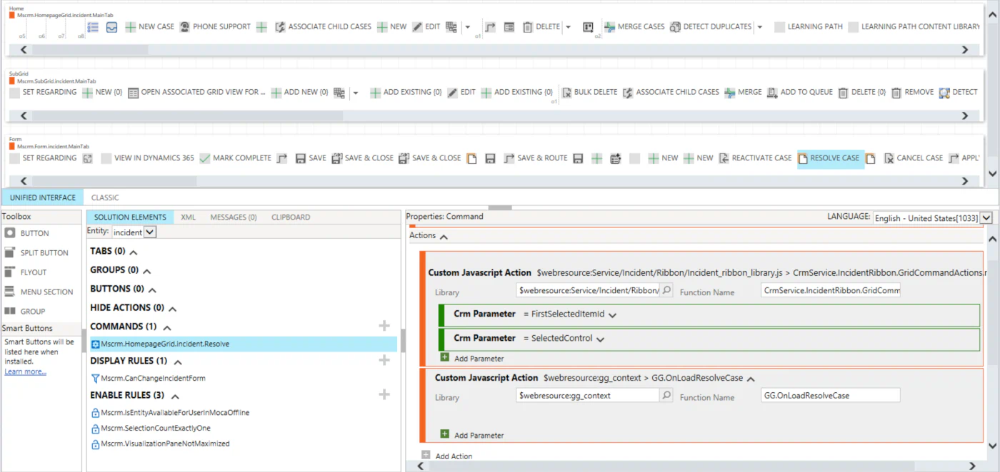

Sometimes in Dynamics 365 we run into scenarios where the standard extension points are simply not enough for what we need to do. This is one of those cases.

In this post, I want to show a practical workaround for accessing and customizing standard experiences such as **Resolve Case**, **Close Opportunity**, and **Bulk Edit**. The goal is not to replace the normal Client API patterns, but to cover those situations where the form context we need is created only after the standard ribbon action has already started.

We will look at how to find that context, wait until it becomes available, work with its controls and attributes, attach additional events such as `OnChange`, and finally connect everything to the existing standard ribbon button using Ribbon Workbench.

The important part is that the JavaScript action starts from the original form or view, but the context I actually need belongs to the UI that Dynamics opens afterwards.

Normally, when working with a form event, getting the context is simple:

```javascript
const formContext = executionContext.getFormContext();
```

For ribbon commands we can also pass supported parameters such as `PrimaryControl` or `SelectedControl`.

But those approaches give us the context that already exists when the command is executed. They do not give us the context of a dialog that Dynamics is about to create.

That was the problem I wanted to solve.

## The problem

Imagine this flow:

```text
Main form or view
      ↓
User clicks a ribbon button
      ↓
Microsoft's standard ribbon action starts
      ↓
Dynamics opens Resolve Case / Opportunity Close / Bulk Edit
      ↓
A new page context becomes available
      ↓
I want to execute my JavaScript against that context
```

For example, on the Resolve Case experience I may want to access a control:

```javascript
context.getControl("ok_id").setDisabled(true);
```

Or I may want to get an attribute and attach an `OnChange` handler:

```javascript
const resolutionType = context.getAttribute("resolutiontypecode");
resolutionType.addOnChange(GG.OnResolutionTypeChange);
```

The challenge is getting the correct context at the right time.

## Finding the context

After investigating how the model-driven app creates these experiences, I found that the additional contexts can be found in the parent window frames.

The basic idea is simple:

```javascript
for (var i = 0; i < parent.frames.length; i++) {
    var frame = parent.frames[i];
    var page = frame && frame.Xrm ? frame.Xrm.Page : null;
}
```

Not every frame contains an `Xrm.Page`, and some frames can also be inaccessible, so I keep the lookup inside a `try/catch`.

For my scenario I also check whether the page represents a dialog:

```javascript
if (page.ui.isDialog()) {
    return page;
}
```

This gives me the context I need.

The complete lookup function is still very small:

```javascript
function getContext() {
    for (var i = 0; i < parent.frames.length; i++) {
        try {
            var frame = parent.frames[i];
            var page = frame && frame.Xrm ? frame.Xrm.Page : null;
            if (!page) continue;

            if (!page.ui) continue;

            if (page.ui.isDialog()) {
                return page;
            }
        } catch (e) {
            continue;
        }
    }

    return null;
}
```

## Why the context must be awaited

There is one more problem.

When the ribbon action starts, Dynamics has not necessarily created the dialog yet.

This means that calling `getContext()` only once can return `null`, even though the dialog appears a fraction of a second later.

The solution I use is a small polling helper:

```javascript
async function waitForContext(timeout = 10000, interval = 100) {
    var start = Date.now();

    while (Date.now() - start < timeout) {
        var context = getContext();
        if (context) return context;

        await new Promise(function (resolve) {
            setTimeout(resolve, interval);
        });
    }

    return null;
}
```

The logic is straightforward:

```text
0 ms     → check
100 ms   → check
200 ms   → check
300 ms   → context exists → return it
```

I use a timeout instead of an infinite loop because there is always a possibility that the expected UI never opens.

For example, the user may cancel the action or Dynamics may stop the operation before creating the new context.

With the defaults above, the helper checks every 100 ms for a maximum of 10 seconds.

## Putting it into a reusable namespace

I prefer to keep this behavior isolated in one helper so the rest of the code stays simple.

This is the complete version I currently use:

```javascript
if (typeof GG == "undefined") {
  GG = {
    __namespace: true,
  };
}

if (typeof GG.Context === "undefined") {
  GG.Context = {
    __namespace: true,
  };
}

GG.Context = (function () {
    function getContext() {
        for (var i = 0; i < parent.frames.length; i++) {
            try {
                var frame = parent.frames[i];
                var page = frame && frame.Xrm ? frame.Xrm.Page : null;
                if (!page) continue;
                
                if(!page.ui) continue;

                if (page.ui.isDialog()) {
                    return page;
                }
            } catch (e) {
                continue;
            }
        }

        return null;
    }

    async function waitForContext(timeout = 10000, interval = 100) {
        var start = Date.now();

        while (Date.now() - start < timeout) {
            var context = getContext();
            if (context) return context;

            await new Promise(function (resolve) {
                setTimeout(resolve, interval);
            });
        }

        return null;
    }

    return {
        GetContextAsync: waitForContext,
    };
})();
```

The rest of the code only needs to call:

```javascript
const context = await GG.Context.GetContextAsync();
```

## Calling the function from the standard ribbon button

Finding the context is only one part of the solution.

The next question is: **when do we start waiting for it?**

For my scenario, I customize the existing standard button using Ribbon Workbench.

The important part is that I keep the original Microsoft JavaScript action and add my own JavaScript action **after it**.



In the screenshot above, the standard Resolve Case command already contains Microsoft's action.

After that action, I add my own JavaScript web resource:

```text
Library: $webresource:gg_context
Function Name: GG.OnLoadResolveCase
```

The sequence is therefore:

```text
User clicks Resolve Case
        ↓
Existing Microsoft action starts
        ↓
Dynamics starts creating the Resolve Case UI
        ↓
GG.OnLoadResolveCase executes
        ↓
GG.Context.GetContextAsync() starts checking
        ↓
The new context becomes available
        ↓
My initialization code runs
```

This is also why the wait helper is important.

Adding the custom JavaScript action after the Microsoft action does not mean that the dialog is already completely created when the next action starts. The standard action can initiate an asynchronous UI operation, so my code waits until the context actually becomes available.

Microsoft's classic ribbon command model supports multiple actions in one command, including JavaScript functions.

## Resolve Case example

Once the new context is available, I can work with it in much the same way as I normally work with a form context.

A simple example is disabling the OK control:

```javascript
GG.OnLoadResolveCase = async function(){
    const context = await GG.Context.GetContextAsync();
    if (!context) return;

    context.getControl("ok_id").setDisabled(true);
}
```

This is useful because I now have access to controls that belong to the newly opened experience instead of the form or view behind it.

## Treating it like OnLoad initialization

An important thing to clarify is that this is **not actually registering a normal form OnLoad event in the form metadata**.

However, from an application logic perspective, it gives us something very similar.

Our ribbon function starts immediately after the standard action, waits for the new context, and then executes initialization logic against the form that just appeared.

Conceptually:

```text
Standard button clicked
        ↓
New form/dialog appears
        ↓
Our code obtains its context
        ↓
Run initialization logic
```

That means we can use this function for the same kind of initialization we would normally place in a form `OnLoad` handler.

For example:

```javascript
GG.OnLoadResolveCase = async function(){
    const context = await GG.Context.GetContextAsync();
    if (!context) return;

    const resolutionType = context.getAttribute("resolutiontypecode");

    if (resolutionType) {
        resolutionType.addOnChange(GG.OnResolutionTypeChange);
    }
}
```

Now we have dynamically attached an `OnChange` handler to the Resolution Type attribute.

Microsoft's Client API supports `attribute.addOnChange(functionReference)`, and the execution context is passed automatically to the registered function.

Our handler can therefore look like a normal form event handler:

```javascript
GG.OnResolutionTypeChange = function(executionContext) {
    const context = executionContext.getFormContext();
    const value = context.getAttribute("resolutiontypecode").getValue();

    console.log("Resolution Type changed:", value);
}
```

This is where the approach becomes much more useful than simply finding a control.

After we get the context, we can:

- Read attributes
- Change attribute values
- Access controls
- Disable or enable controls
- Change visibility
- Add `OnChange` handlers
- Execute additional Client API logic

For me, this makes the ribbon function behave like an initialization hook for the UI that Dynamics has just opened.

## Bulk Edit example

The same idea can also be used when working with Bulk Edit.

For example:

```javascript
GG.OnLoadOnBulkEdit = async function(){
    const context = await GG.Context.GetContextAsync();
    if (!context) return;

    console.log("Bulk Edit context:", context);
}
```

Once the context is available, I can retrieve the attributes and controls available in the Bulk Edit experience and apply the logic I need.

The main purpose of this example is not the `console.log`. It is that I now have a reference to the newly created context and can work with it from my custom JavaScript.

The Ribbon Workbench setup follows the same idea: keep the standard action that opens the experience and add the custom JavaScript action afterwards.

## Bonus: stronger context validation

For my current scenario, the small `isDialog()` check is enough.

However, depending on the solution, you may want to make the lookup stricter.

There are several simple validations that can be added without changing the overall approach.

### Check the form type

Microsoft provides the supported `formContext.ui.getFormType()` method.

Some important values are:

```text
1 = Create
2 = Update
3 = Read Only
4 = Disabled
6 = Bulk Edit
```

Quick Create forms return `1`.

This means that for a create-style dialog you can add another check:

```javascript
if (page.ui.isDialog() && page.ui.getFormType() === 1) {
    return page;
}
```

For Bulk Edit, you can explicitly check:

```javascript
if (page.ui.getFormType() === 6) {
    return page;
}
```

This can be useful when the same helper is used by several different commands.

### Check that an expected control exists

Another simple validation is checking for a control that should exist only in the form you expect.

For example:

```javascript
if (
    page.ui.isDialog() &&
    page.getControl("ok_id")
) {
    return page;
}
```

Or combine both checks:

```javascript
if (
    page.ui.isDialog() &&
    page.ui.getFormType() === 1 &&
    page.getControl("ok_id")
) {
    return page;
}
```

This gives us a simple sequence of checks:

```text
Is this a dialog?
        ↓
Is it a Create form?
        ↓
Does it contain the control I expect?
        ↓
Return the context
```

I would only add these validations when they are useful for the specific scenario. I prefer keeping the base helper small and understandable.

## A note about supportability

There is an important trade-off with this approach.

When JavaScript is registered directly on a form event, the recommended API is:

```javascript
executionContext.getFormContext();
```

For ribbon commands, Microsoft also provides supported command parameters such as `PrimaryControl` and `SelectedControl`.

`Xrm.Page` is deprecated in favor of `formContext`, although Microsoft still maintains it for backward compatibility.

This solution is different because I need to discover **another context that Dynamics creates after the original command has started**.

There is no public Client API such as:

```javascript
Xrm.getOpenDialogs();
```

or:

```javascript
Xrm.getAllFormContexts();
```

that gives me all newly created contexts.

Because of that, this solution relies on runtime behavior by enumerating `parent.frames`.

Also, `page.ui.isDialog()` is not part of the documented public `formContext.ui` Client API.

For that reason, I consider this a workaround rather than a fully supported Client API pattern.

I keep the unsupported part isolated inside `GG.Context`, while the code that runs after I obtain the context uses normal Client API methods such as:

```javascript
context.getAttribute(...)
context.getControl(...)
context.ui.getFormType()
attribute.addOnChange(...)
```

If Microsoft changes the internal runtime behavior in the future, I only need to revisit the small context-discovery helper instead of changing all of my business logic.

## Final example

Putting everything together, the JavaScript web resource can stay very small:

```javascript
if (typeof GG == "undefined") {
  GG = {
    __namespace: true,
  };
}

if (typeof GG.Context === "undefined") {
  GG.Context = {
    __namespace: true,
  };
}

GG.Context = (function () {
    function getContext() {
        for (var i = 0; i < parent.frames.length; i++) {
            try {
                var frame = parent.frames[i];
                var page = frame && frame.Xrm ? frame.Xrm.Page : null;
                if (!page) continue;
                
                if(!page.ui) continue;

                if (page.ui.isDialog()) {
                    return page;
                }
            } catch (e) {
                continue;
            }
        }

        return null;
    }

    async function waitForContext(timeout = 10000, interval = 100) {
        var start = Date.now();

        while (Date.now() - start < timeout) {
            var context = getContext();
            if (context) return context;

            await new Promise(function (resolve) {
                setTimeout(resolve, interval);
            });
        }

        return null;
    }

    return {
        GetContextAsync: waitForContext,
    };
})();

GG.OnLoadOnBulkEdit = async function(){
    const context = await GG.Context.GetContextAsync();
    if (!context) return;

    console.log("Context:", context);
}

GG.OnLoadResolveCase = async function(){
    const context = await GG.Context.GetContextAsync();
    if (!context) return;

    context.getControl("ok_id").setDisabled(true);

    const resolutionType = context.getAttribute("resolutiontypecode");

    if (resolutionType) {
        resolutionType.addOnChange(GG.OnResolutionTypeChange);
    }
}

GG.OnResolutionTypeChange = function(executionContext) {
    const context = executionContext.getFormContext();
    const value = context.getAttribute("resolutiontypecode").getValue();

    console.log("Resolution Type changed:", value);
}
```

The interesting part is not the amount of code. It is that a small helper gives us access to a context that did not exist when the ribbon command started.

From there, we can use normal Client API concepts to initialize the newly opened UI and register additional behavior when needed.

## References

- [Client API form context](https://learn.microsoft.com/en-us/power-apps/developer/model-driven-apps/clientapi/clientapi-form-context)
- [getFormType Client API reference](https://learn.microsoft.com/en-us/power-apps/developer/model-driven-apps/clientapi/reference/formcontext-ui/getformtype)
- [addOnChange Client API reference](https://learn.microsoft.com/en-us/power-apps/developer/model-driven-apps/clientapi/reference/attributes/addonchange)
- [Define ribbon actions](https://learn.microsoft.com/en-us/power-apps/developer/model-driven-apps/define-ribbon-actions)
- [Case Resolution table reference](https://learn.microsoft.com/en-us/dynamics365/developer/reference/entities/incidentresolution)
